# 结算流程验收报告（F4 作业费结算单）

> 面向没参加评审会的人：不需要懂代码，按"问题 → 改了什么 → 一步步验证"读完即可。
> 报告里每张截图都来自真实运行的服务，可用一条命令完整复现（见文末"如何复现"）。

## 1. 要解决什么问题

| 原来的问题 | 现在的做法 |
| --- | --- |
| 每月结算要把作业单导出 Excel，人工筛选、算钱，**数据要二次加工才能用** | 系统内一键生成结算单：已完工未结算的作业单自动汇总，明细面积/单价/金额直接落库 |
| 结算单**状态乱跳**（草稿直接付款、付完款又改），引发数据错乱 | 上状态机：只允许配置过的流转，**非法迁移即拒绝**，终态不可再改 |
| 流转规则写在代码里，调整要找开发改代码发版 | **迁移规则配置化**：存配置表，在线可查可启停，即时生效、重启不丢 |
| 多人同时改一张单，后提交的覆盖先提交的，谁也发现不了 | **每次变更必须带版本**，版本不一致即拒绝；**每步都记录操作人** |
| 出了问题查不到"谁在什么时候把状态改成了什么" | **流转历史完整**：每次变更记录前后状态、前后版本、操作人、请求号、时间 |

## 2. 结算单状态机

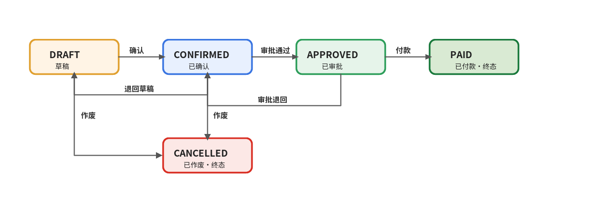

- 主流程：`DRAFT 草稿 → CONFIRMED 已确认 → APPROVED 已审批 → PAID 已付款`
- 终态：`PAID`（已付款）、`CANCELLED`（已作废），终态后任何变更都会被拒绝
- 退回边：`CONFIRMED → DRAFT`（退回草稿）、`APPROVED → CONFIRMED`（审批退回）
- 作废：`DRAFT`/`CONFIRMED → CANCELLED`，作废必须填原因；作废后作业单与期间释放，可重新生成结算单
- 以上 7 条规则全部来自配置表 `t_settlement_transition`，不是写死的代码

## 3. 验收环境与步骤

- 服务：本工作区 `evops-base`，验收走查使用独立验收库（`data/evops-acceptance`），不影响日常数据
- 走查脚本：`docs/acceptance/run-acceptance.sh`（启动服务 → 逐步调用真实接口 → 生成截图）
- 每张截图的样式：第一行 `#` 是这一步在做什么，`$` 是实际执行的命令，下面是服务的真实返回

## 4. 逐步验证

### 步骤 1 ｜ 准备数据：农机建档 + 两张作业单完工

建一台收割机、两张收割作业单（东洼子 3 号地 12.50 亩、西坡 7 号地 8.30 亩），登记轨迹核算面积并完工。只有**已完工**的作业单才会进入结算。

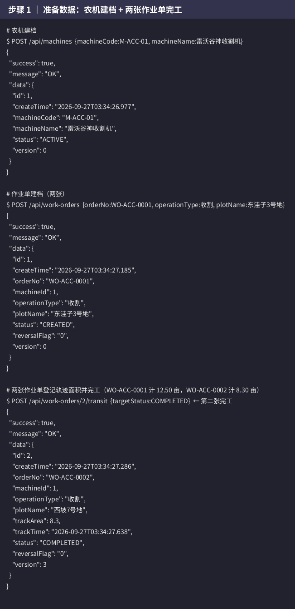

### 步骤 2 ｜ 生成结算单：完工单自动汇总，金额自动算好

调用一次"生成结算单"（期间 2026-09、单价 80 元/亩），系统自动挑出已完工未结算的两张单，算出每张明细金额（12.50×80=1000、8.30×80=664）与合计（20.8 亩、1664 元）。**不再导出 Excel 二次加工**。

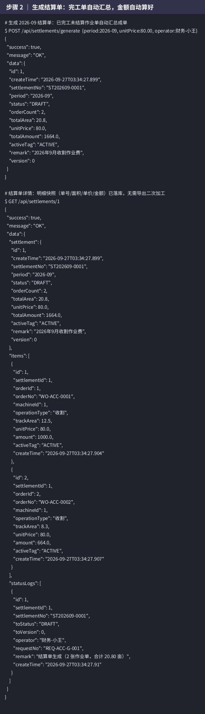

### 步骤 3 ｜ 非法迁移即拒绝：草稿不能直接付款

结算单还是草稿（DRAFT），直接请求"付款"（PAID）被状态机拒绝，返回里明确给出**当前允许去的方向**。这就是"状态乱跳"的兜底。

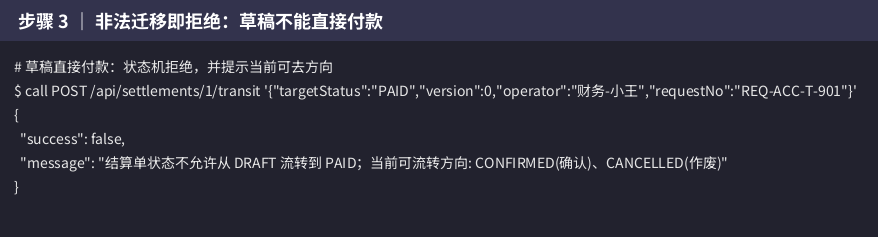

### 步骤 4 ｜ 版本不一致即拒绝：防止多人同时改乱

故意带一个过期版本（version=9）请求流转，被拒绝并提示当前版本。每个人看到的版本对不上就改不了，杜绝"你改了我不知道"。

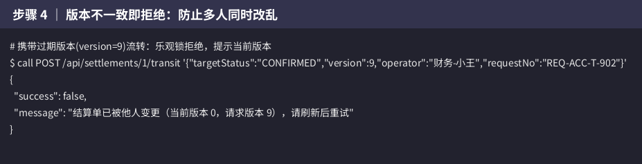

### 步骤 5 ｜ 正常流转：带版本与操作人，确认成功

带上当前版本（0）和操作人（财务-小王），DRAFT → CONFIRMED 成功，版本自动变成 1。之后每次变更都要带上一次的版本。

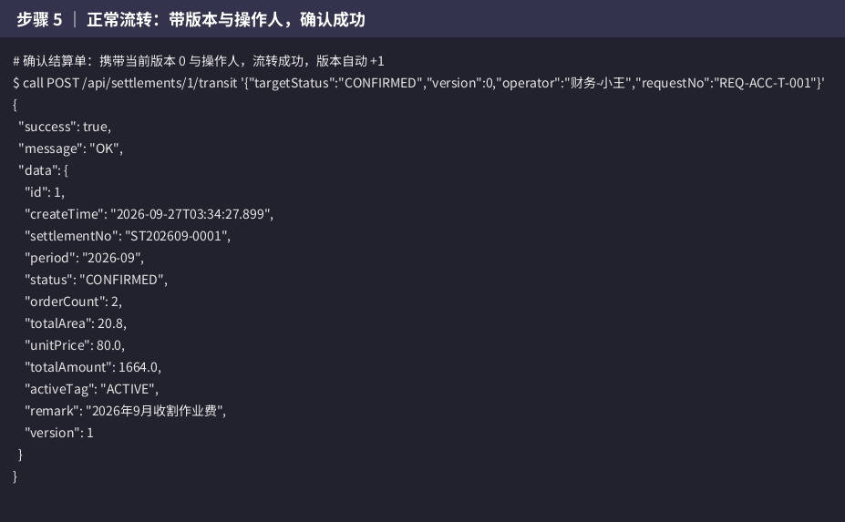

### 步骤 6 ｜ 迁移规则配置化：7 条规则在线可查

`GET /api/settlements/transitions` 返回全部 7 条迁移规则（来自配置表，含中文动作名与启停状态）。改规则不用改代码。

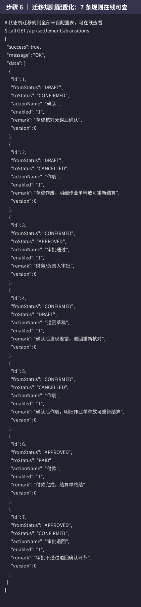

### 步骤 7 ｜ 停用规则立即生效：审批被拦截，启用后恢复

管理员在线停用"已确认 → 已审批"规则后，审批流转立即被拒（提示规则已停用）；重新启用后恢复。规则调整**即时生效、不需要重启服务**。

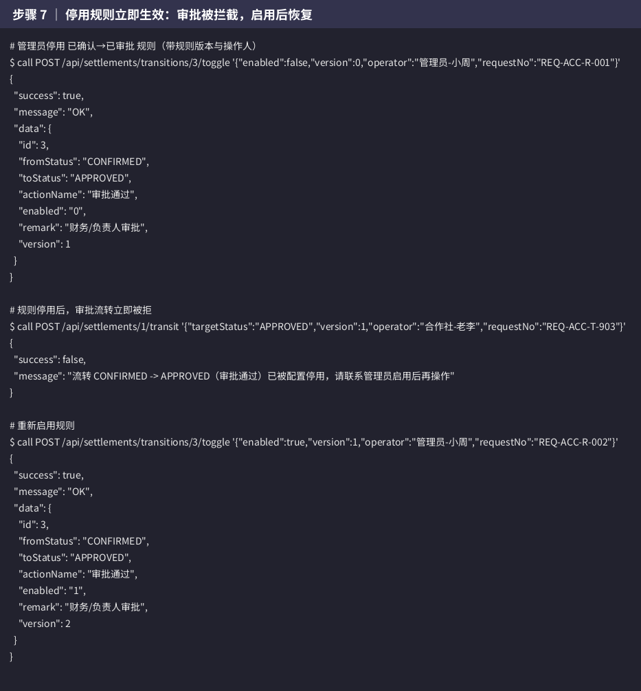

### 步骤 8 ｜ 审批、付款走完主流程

规则恢复后，合作社负责人审批通过（CONFIRMED → APPROVED），出纳付款（APPROVED → PAID），每步都带版本与操作人。

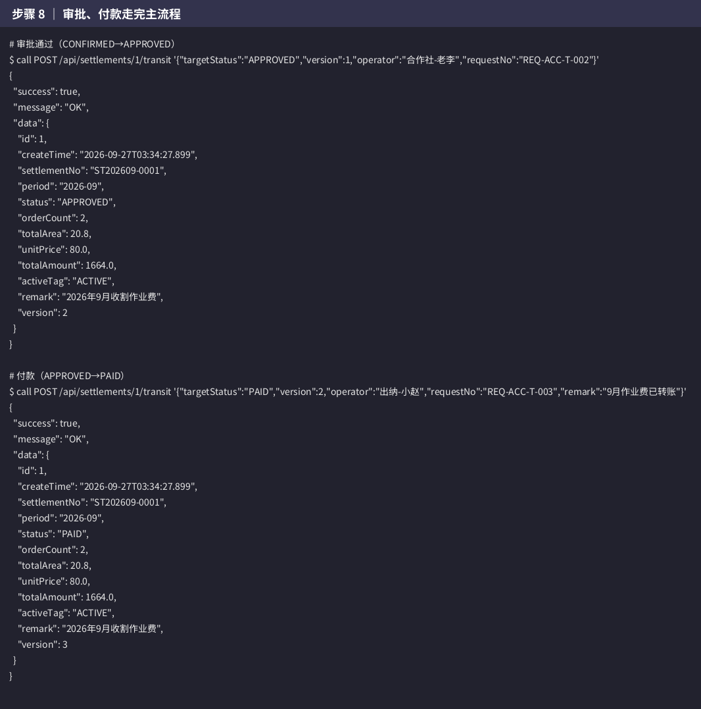

### 步骤 9 ｜ 终态保护：已付款不可再变更

已付款（PAID）是终态，再请求任何流转都被拒绝，提示"终态"。付款后的数据不会再被改乱。

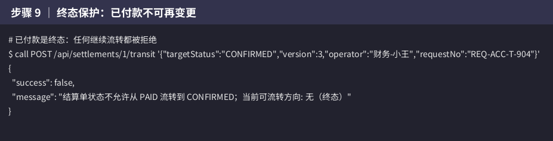

### 步骤 10 ｜ 流转历史完整：每步带版本与操作人

结算单详情里的 `statusLogs`：从生成到付款共 4 条记录，每条都有**前后状态、前后版本、操作人、请求号、时间**。出了问题可以一笔一笔追。

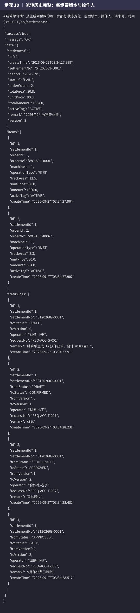

### 步骤 11 ｜ 作废释放：历史保留，可重新结算

新期间（2026-10）生成一张结算单后演示作废：空原因被拒绝；带原因作废成功；作废后该作业单与期间都释放，可以按正确单价重新生成（单号序号不复用，新单为 -0002）。**历史单据保留不删，全程可查。**

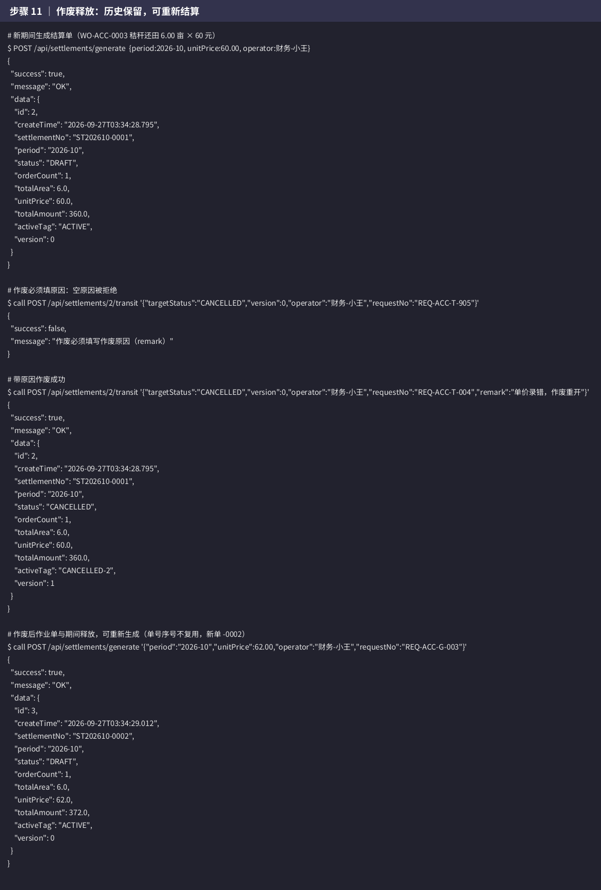

## 5. 验收结论对照

| 验收要求 | 验证步骤 | 结果 |
| --- | --- | --- |
| 数据不再二次加工 | 步骤 2：一键生成，明细金额自动落库 | ✅ |
| 上状态机 | 步骤 2、6：状态机图与配置一致 | ✅ |
| 迁移规则配置化 | 步骤 6、7：规则可查、在线启停即时生效 | ✅ |
| 入口统一校验 | 步骤 3、4、5、9：所有变更走同一入口，统一校验 | ✅ |
| 非法迁移即拒绝 | 步骤 3（跳级）、9（终态） | ✅ |
| 每次变更带版本与操作人 | 步骤 4（版本拒绝）、5（版本+操作人成功） | ✅ |
| 状态变更带版本 | 步骤 10：每条历史带前后版本 | ✅ |
| 流转历史完整 | 步骤 10：生成到付款 4 条全记录 | ✅ |
| 作废可追溯、可重新结算 | 步骤 11 | ✅ |

自动化测试同步覆盖以上场景：`SettlementFlowTest`（8 个用例）、`SettlementApiTest`（3 个用例），`mvn test` 全部通过。

## 6. 如何复现

```bash
# 1. 构建并跑自动化测试
mvn test

# 2. 一键复现本报告全部截图（自动起服务、走查、出图）
docs/acceptance/run-acceptance.sh
```

- 走查使用独立验收库 `data/evops-acceptance`，每次运行先清空，不影响 `data/evops` 日常数据
- 截图由 `docs/acceptance/ShotRenderer.java`（JDK 自带 AWT，零外部依赖）渲染；中文字体脚本自动下载到 `docs/acceptance/fonts/`；状态机示意图由 `render-state-diagram.sh`（ImageMagick）生成
